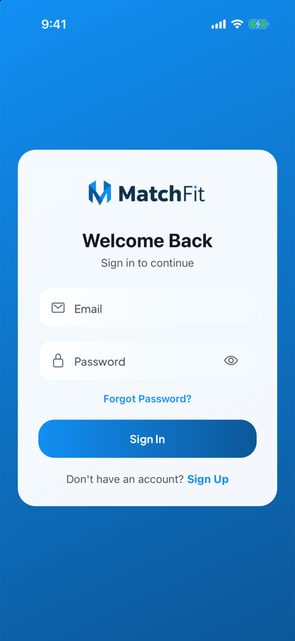
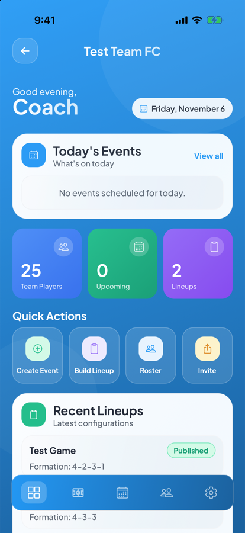
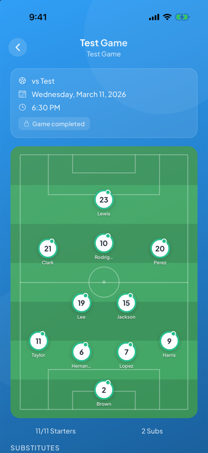
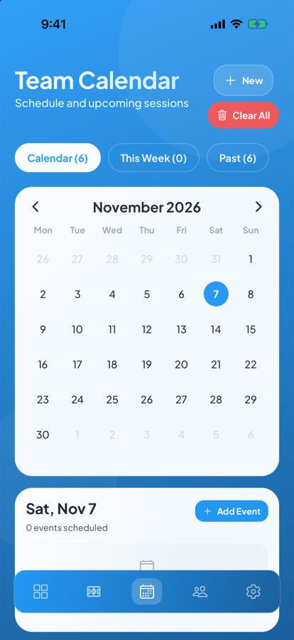

# MatchFit Mobile

MatchFit is an iOS and Android app for running an amateur or youth soccer team. Coaches create a team, invite players with a code, schedule games and practices, collect RSVPs, and build match-day lineups on a visual pitch. Players join with the invite code, see what's coming up, and RSVP from their phone.

<p align="center">
  
  
  
  
</p>

## Who it's for

- **Coaches** who currently run their team through group chats and spreadsheets: they get one place for the roster, the schedule, who's available, and the starting XI.
- **Players** (and parents of younger players) who just want to know when and where the next game is and tell the coach whether they're coming.

## Features

- **Accounts and onboarding**: email sign-up and sign-in with password reset, then a role-specific onboarding flow for coaches and players.
- **Teams**: create a team, invite players and assistant coaches with invite codes, and import a roster by pasting a list of names (optionally with email, jersey number and position).
- **Events**: games and practices with recurrence, home/away venue, and edit and delete.
- **RSVPs**: players respond to each event; coaches see who's in, out, or hasn't answered.
- **Lineups**: pick a formation (4-3-3, 4-4-2, 3-5-2, 4-2-3-1, 3-4-3, 4-1-4-1), tap each position on the pitch to assign a player, and publish the lineup to the team. Published lineups are versioned.
- **Reliability**: an offline banner when the network drops, a Sentry error boundary, and atomic database functions for multi-step writes such as creating a team or deleting one.

## Tech stack

| Layer | Tools |
|-------|-------|
| App | React Native 0.81, Expo SDK 54, Expo Router 6 (file-based navigation), TypeScript |
| UI | NativeWind 4 (Tailwind for React Native), Reanimated 4, Expo Linear Gradient, Plus Jakarta Sans |
| Backend | Supabase: Postgres, Auth, Row Level Security, SQL functions (RPCs) |
| Storage | Expo Secure Store for the auth session, AsyncStorage |
| Monitoring | Sentry (`@sentry/react-native`), optional |
| Tests | Jest with `ts-jest`, 90 tests across utilities and hooks |

## Getting started

### Prerequisites

- Node.js 18 or newer and npm
- macOS with Xcode and an iOS Simulator (for iOS), or Android Studio with an emulator (for Android)
- CocoaPods (`brew install cocoapods`) for iOS builds
- A free [Supabase](https://supabase.com) project

### 1. Clone and install

```bash
git clone https://github.com/ManuRodriguez10/MatchFit-Mobile.git
cd MatchFit-Mobile
npm ci
```

### 2. Set up the database

Run every file in `supabase/migrations/` **in filename order** against your Supabase project. Either:

- **Supabase CLI**: `supabase link --project-ref <your-project-ref>` then `supabase db push`, or
- **Dashboard**: open **SQL Editor** and paste each file in order.

All migrations use `IF NOT EXISTS` / `CREATE OR REPLACE` and are safe to re-run. To check your setup, run `supabase/migrations/verify_setup.sql` in the SQL Editor; every check should show ✅.

In **Authentication → Settings**, decide whether email confirmation is on. If it is, set the Site URL to the app's deep-link scheme (`matchfit://`).

### 3. Configure environment variables

```bash
cp .env.example .env
```

Fill in `.env` from your Supabase dashboard (**Project Settings → API**):

| Variable | Required | What it is |
|----------|----------|------------|
| `EXPO_PUBLIC_SUPABASE_URL` | Yes | Your project URL, e.g. `https://abcd1234.supabase.co` |
| `EXPO_PUBLIC_SUPABASE_ANON_KEY` | Yes | The project's **anon / publishable** key |
| `EXPO_PUBLIC_SENTRY_DSN` | No | Sentry DSN for error reporting; Sentry stays off in development |

`.env` is gitignored. Never put the Supabase **service role** key in this app.

> **Why the anon key is in the app:** every `EXPO_PUBLIC_*` variable is compiled into the app bundle, so anyone with the app can read it. That's how Supabase is meant to be used: the anon key only grants what the Row Level Security policies allow, and RLS is enabled on every table (`profiles`, `teams`, `team_coaches`, `team_players`, `events`, `rsvps`, `coach_invites`, `lineups`, `lineup_players`). Anything that needs elevated access belongs in a Supabase Edge Function or SQL function, not in the client.

### 4. Run it

```bash
npm run ios       # build and launch in the iOS Simulator
npm run android   # build and launch in an Android emulator
npm start         # start Metro only (if a dev build is already installed)
```

The first `npm run ios` generates the native project, installs CocoaPods and builds the app, which takes a few minutes.

### 5. Run the tests

```bash
npm test
```

## Project structure

```
app/                     Expo Router screens
  (auth)/                Login and sign-up
  (onboarding)/          First-run flow for coaches and players
  (tabs)/                Main app
    team/[teamId]/       Team dashboard, roster, events, lineups, settings
components/              Shared UI (ui/) and lineup builder (lineup/)
contexts/                AuthContext: session, profile, sign-in/out
hooks/                   Network status, throttled callbacks
lib/                     Supabase client, Sentry, invite-code helpers
utils/                   Event date/recurrence helpers
constants/               Colors, formations, UI tokens
supabase/migrations/     SQL schema, RLS policies, RPCs, indexes
__tests__/               Jest tests
```

## Troubleshooting

- **"Database error saving new user" on sign-up**: the migrations haven't all been applied. Run `verify_setup.sql` to see what's missing, then apply the missing migrations in order.
- **`pod install` fails with `Unicode Normalization not appropriate for ASCII-8BIT`**: your shell isn't using a UTF-8 locale. Run `export LANG=en_US.UTF-8` and try again.
- **Metro shows stale code**: `npx expo start -c` clears the bundler cache.
- **Port 8081 already in use**: `lsof -ti:8081 | xargs kill -9`.

## Roadmap

See [ROADMAP.md](ROADMAP.md) for planned work.

## License

[MIT](LICENSE) © 2026 Manuel Rodriguez
